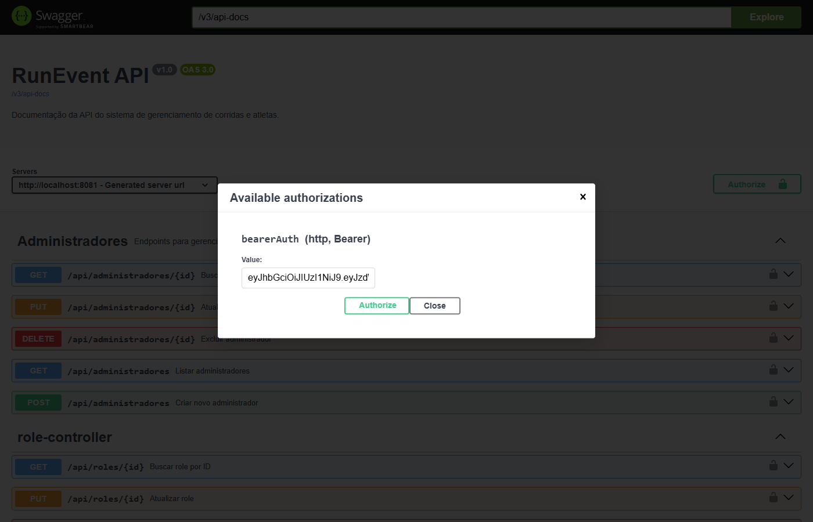

# RunEvent

API REST para gerenciamento de corridas de rua: cadastro de atletas, organizadores (administradores), categorias, corridas, inscrições e resultados.

📚 **Documentação completa em [`docs/`](docs/README.md)**: arquitetura, diagramas UML e ER, referência da API, segurança, telas e testes.



## Stack

- Java 21 + Spring Boot 3.2
- Spring Web, Spring Data JPA (Hibernate)
- Spring Security com autenticação JWT (jjwt)
- PostgreSQL + Flyway para versionamento do schema
- springdoc-openapi (Swagger UI)
- JUnit 5, Mockito e MockMvc nos testes

## Arquitetura

O código fica em `src/main/java/com/example/runevent`, organizado em camadas:

| Pacote | Responsabilidade |
|---|---|
| `controller` | Endpoints REST (`/api/...`) |
| `service` | Regras de negócio e validações |
| `repository` | Acesso a dados (Spring Data JPA) |
| `model` | Entidades JPA |
| `dto` / `dto/mapper` | Objetos de entrada/saída e conversão entidade ↔ DTO |
| `security` | Geração/validação de JWT e filtro de autenticação |
| `config` | Segurança, CORS e Swagger |
| `exeptions` | Tratamento global de erros (`@ControllerAdvice`), com respostas JSON padronizadas |

## Modelo de domínio

| Entidade | Descrição | Relacionamentos |
|---|---|---|
| `Login` | Credenciais (e-mail único, senha) e tipo de usuário (`ADM` ou `ATLETA`) | 1:1 com Administrador ou Atleta |
| `Administrador` | Organizador de corridas | 1:N com Corrida |
| `Atleta` | Participante (nome, data de nascimento, gênero) | N:1 com Categoria, N:N com Role |
| `Categoria` | Faixa/categoria de competição | 1:N com Atleta |
| `Corrida` | Evento (nome, data, local, distância) | N:1 com Administrador |
| `Participacao` | Inscrição de um atleta em uma corrida (chave composta) | N:1 com Atleta e Corrida |
| `Resultado` | Tempo, colocação geral e colocação na categoria | N:1 com Atleta e Corrida |
| `Role` | Perfil de acesso (`ADMIN`, `USER`) | N:N com Atleta |

O schema é criado e populado com dados de exemplo pelas migrações em `src/main/resources/db/migration` (`V1` a `V18`). O Hibernate não altera o banco (`ddl-auto=none`): toda mudança de schema deve ser feita por uma nova migração Flyway.

## Endpoints

Todos sob o prefixo `/api`. A documentação interativa completa fica no Swagger (veja abaixo).

| Recurso | Rotas |
|---|---|
| Autenticação | `POST /auth/login` |
| Atletas | `GET /atletas`, `GET /atletas/{id}`, `POST /atletas`, `PUT /atletas/{id}`, `DELETE /atletas/{id}` |
| Administradores | `GET /administradores`, `GET /administradores/{id}`, `POST /administradores`, `PUT /administradores/{id}`, `DELETE /administradores/{id}` |
| Categorias | `GET /categorias`, `GET /categorias/{id}`, `POST /categorias`, `PUT /categorias/{id}`, `DELETE /categorias/{id}` |
| Corridas | `GET /corridas`, `GET /corridas/{id}`, `POST /corridas?idAdm=`, `PUT /corridas/{id}?idAdm=`, `DELETE /corridas/{id}` |
| Inscrições | `POST /participacoes?idAtleta=&idCorrida=`, `GET /participacoes/corrida/{idCorrida}`, `DELETE /participacoes?idAtleta=&idCorrida=` |
| Resultados | `POST /resultados?idAtleta=&idCorrida=`, `GET /resultados/corrida/{idCorrida}` |
| Roles | `GET /roles`, `GET /roles/{id}`, `GET /roles/buscar?descricao=`, `POST /roles`, `PUT /roles/{id}`, `DELETE /roles/{id}` |

Datas em JSON usam o formato ISO `yyyy-MM-dd` (ex.: `"1995-05-10"`). Detalhes e exemplos em [docs/04-api.md](docs/04-api.md).

## Autenticação

1. Faça login com e-mail e senha de um atleta:

   ```http
   POST /api/auth/login
   Content-Type: application/json

   { "email": "atleta@exemplo.com", "senha": "..." }
   ```

2. Use o token retornado nas demais requisições:

   ```http
   Authorization: Bearer <token>
   ```

Regras de acesso:

- Públicos: `/api/auth/**`, cadastro de atleta (`POST /api/atletas`) e o Swagger.
- `GET /api/atletas/**`: perfis `ADMIN` ou `USER`.
- `PUT` e `DELETE /api/atletas/**`: perfil `ADMIN`.
- Demais rotas: qualquer usuário autenticado.

As senhas são armazenadas com BCrypt. O token expira em 24 h. A chave e a expiração podem ser configuradas pelas propriedades `jwt.secret` e `jwt.expiration` (ms). Em produção, defina sempre uma `jwt.secret` própria.

## Como executar

Pré-requisitos: JDK 21 e PostgreSQL. O Maven não precisa estar instalado, porque o projeto usa o Maven Wrapper.

1. Crie o banco:

   ```sql
   CREATE DATABASE runevent;
   ```

2. Informe as credenciais por variáveis de ambiente. Sem elas, o padrão é `postgres` / `carlos` em `localhost:5432/runevent`:

   | Variável | Padrão |
   |---|---|
   | `DB_URL` | `jdbc:postgresql://localhost:5432/runevent` |
   | `DB_USERNAME` | `postgres` |
   | `DB_PASSWORD` | `carlos` |

3. Suba a aplicação:

   ```bash
   ./mvnw spring-boot:run        # Linux/macOS
   mvnw.cmd spring-boot:run      # Windows
   ```

   O Flyway aplica as migrações automaticamente na inicialização.

A API sobe na porta **8081**:

- Swagger UI: http://localhost:8081/swagger-ui/index.html. Faça login em `/api/auth/login` e cole o token no botão **Authorize** (passo a passo em [docs/06-telas.md](docs/06-telas.md)).
- Especificação OpenAPI: http://localhost:8081/v3/api-docs

## Testes

```bash
./mvnw test
```

- `src/test/.../service`: testes unitários dos services, com repositórios mockados (Mockito).
- `src/test/.../controller`: testes da camada web com `@WebMvcTest` e MockMvc, com services mockados e filtros de segurança desativados.
- `RuneventApplicationTests`: sobe o contexto completo e **precisa de um PostgreSQL acessível** com as credenciais configuradas acima.

## Limitações conhecidas

As principais (lista completa em [docs/08-limitacoes-e-melhorias.md](docs/08-limitacoes-e-melhorias.md)):

- As respostas JSON incluem o campo `login.senha`. Isso expõe o hash BCrypt dos atletas e a senha em texto puro dos administradores, que também não é criptografada ao salvar.
- Só as rotas de `/api/atletas` exigem perfil. As demais aceitam qualquer usuário autenticado.
- O login (`/api/auth/login`) só autentica **atletas**, e atletas novos não recebem role automaticamente.
- A dependência `spring-boot-starter-validation` está comentada no `pom.xml`, então `@Valid`/`@NotBlank` não são aplicados.
- Recurso inexistente responde 400, e não 404.

## Documentação

| Documento | Conteúdo |
|---|---|
| [Visão geral](docs/01-visao-geral.md) | Atores, casos de uso, requisitos e regras de negócio |
| [Arquitetura](docs/02-arquitetura.md) | Camadas, componentes, fluxo de requisição e implantação |
| [Modelo de dados](docs/03-modelo-de-dados.md) | Diagrama de classes UML, diagrama ER e migrações |
| [Referência da API](docs/04-api.md) | Endpoints com exemplos reais |
| [Segurança](docs/05-seguranca.md) | JWT, perfis e matriz de permissões |
| [Telas](docs/06-telas.md) | Prints do Swagger UI passo a passo |
| [Testes](docs/07-testes.md) | Estratégia e execução |
| [Limitações e melhorias](docs/08-limitacoes-e-melhorias.md) | Problemas conhecidos e próximos passos |

A especificação e o relatório originais da disciplina também estão em [`docs/`](docs/).

## Autores

Carlos Alves e Edson Schmitz
