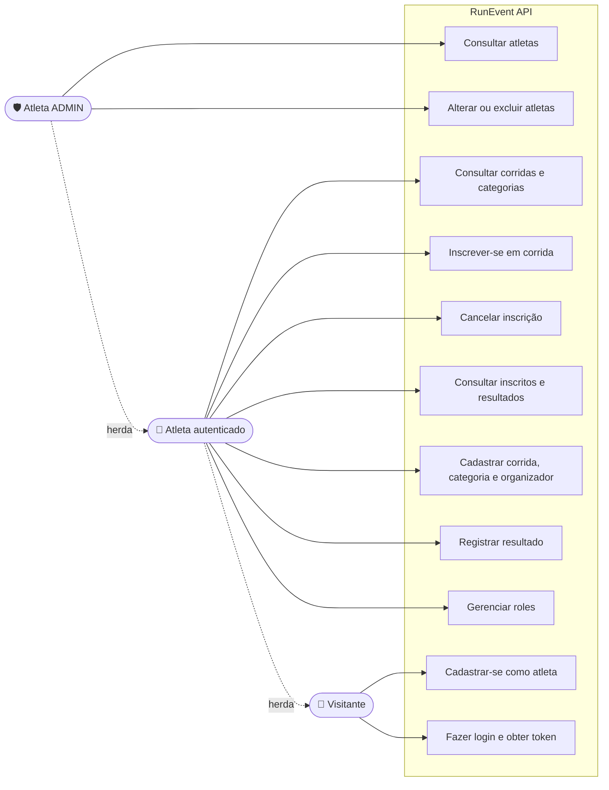

# 1. Visão geral

## Objetivo

O RunEvent é uma API REST para organizar corridas de rua. Ela centraliza o cadastro de atletas e de organizadores, as categorias de competição, o calendário de corridas, as inscrições e os resultados de cada prova.

A API é consumida por clientes como apps mobile, front-ends web ou ferramentas como Postman e Swagger UI. O sistema não tem interface própria: a interface de uso documentada aqui é o [Swagger UI](06-telas.md).

## Atores

| Ator | Quem é | Como acessa |
|---|---|---|
| **Visitante** | Qualquer pessoa sem conta | Só pode se cadastrar como atleta e fazer login |
| **Atleta** | Corredor cadastrado | Faz login e recebe um token JWT |
| **Atleta com perfil `USER`** | Atleta com a role `USER` atribuída | Também consulta dados de atletas |
| **Atleta com perfil `ADMIN`** | Atleta com a role `ADMIN` atribuída | Também altera e exclui atletas |
| **Administrador (organizador)** | Entidade `Administrador`, dona das corridas | Ainda **não** faz login pela API; é referenciado por `idAdm` na criação de corridas |

> Os perfis de acesso (`ADMIN`/`USER`) ficam ligados ao **atleta**, não à entidade `Administrador`. Veja [Segurança](05-seguranca.md).

## Casos de uso

Hoje, qualquer usuário autenticado pode criar corridas e registrar resultados, porque só as rotas de `/api/atletas` exigem perfil. Isso está listado em [Limitações](08-limitacoes-e-melhorias.md).

## Requisitos funcionais

| ID | Requisito | Endpoint(s) |
|---|---|---|
| RF01 | Cadastrar atleta com login (e-mail e senha) e categoria opcional | `POST /api/atletas` |
| RF02 | Autenticar com e-mail e senha e devolver um token JWT | `POST /api/auth/login` |
| RF03 | Manter categorias (CRUD) | `/api/categorias` |
| RF04 | Manter organizadores (CRUD) | `/api/administradores` |
| RF05 | Manter corridas vinculadas a um organizador (CRUD) | `/api/corridas` |
| RF06 | Inscrever e desinscrever atleta em corrida | `/api/participacoes` |
| RF07 | Listar inscritos de uma corrida | `GET /api/participacoes/corrida/{id}` |
| RF08 | Registrar o resultado de um atleta em uma corrida | `POST /api/resultados` |
| RF09 | Listar resultados de uma corrida | `GET /api/resultados/corrida/{id}` |
| RF10 | Manter perfis de acesso (roles) | `/api/roles` |

## Requisitos não funcionais

| ID | Requisito | Como é atendido |
|---|---|---|
| RNF01 | API stateless | JWT, sem sessão no servidor (`SessionCreationPolicy.STATELESS`) |
| RNF02 | Senhas não armazenadas em texto puro | BCrypt no cadastro e na atualização de atleta |
| RNF03 | Schema versionado e reprodutível | Flyway (`V1`…`V18`), com o Hibernate sem alterar o banco |
| RNF04 | API autodocumentada | OpenAPI 3 com Swagger UI |
| RNF05 | Erros em formato padronizado | `GlobalExceptionHandler` devolve `{timestamp, message, details}` |
| RNF06 | Consumo por clientes de outras origens | CORS liberado para qualquer origem |
| RNF07 | Cobertura de testes automatizados | JUnit 5, Mockito e MockMvc nos services e controllers |

## Regras de negócio

| ID | Regra | Onde é aplicada |
|---|---|---|
| RN01 | O e-mail de login é único no sistema | `LoginService.validateEmailUniqueness` e constraint `UNIQUE` |
| RN02 | Um atleta cadastrado pela API recebe sempre `tipo = ATLETA` | `AtletaService.create` |
| RN03 | A senha do atleta é criptografada antes de ser salva | `AtletaService.create` / `update` |
| RN04 | A categoria informada no cadastro precisa existir | `AtletaService.create` |
| RN05 | Toda corrida pertence a um organizador existente | `CorridaService.create` (parâmetro `idAdm`) |
| RN06 | Um atleta não pode se inscrever duas vezes na mesma corrida | `ParticipacaoService.create` e chave primária composta |
| RN07 | O resultado precisa referenciar um atleta e uma corrida existentes | `ResultadoService.create` |
| RN08 | A descrição de uma role é obrigatória e única | `RoleService.criar` |
| RN09 | Gênero aceita apenas `M`, `F` ou `OUTRO` | enum `Atleta.Genero` e `CHECK` no banco |
