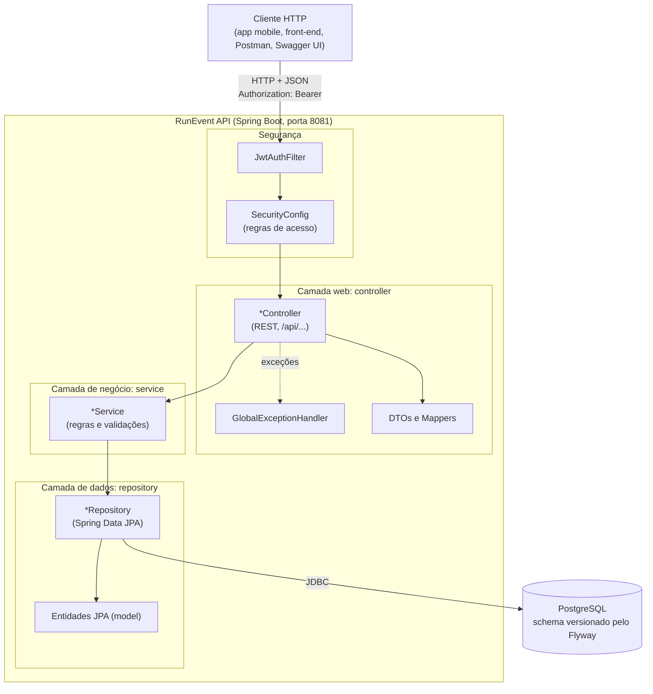
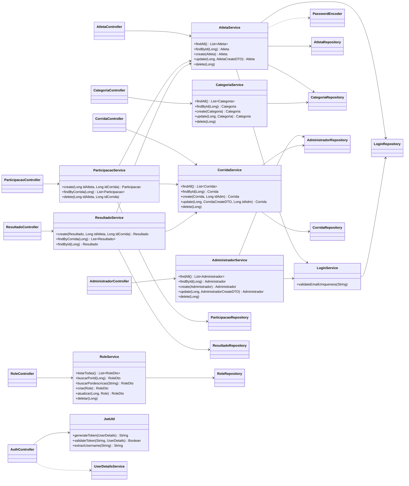
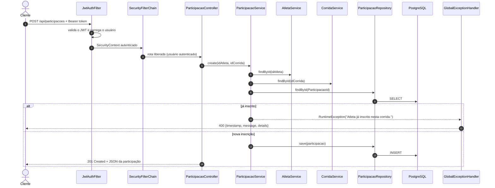
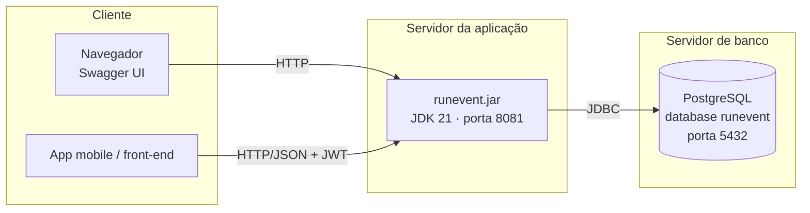

# 2. Arquitetura

## Stack

| Camada | Tecnologia | Versão |
|---|---|---|
| Linguagem | Java | 21 |
| Framework | Spring Boot | 3.2.5 |
| Web | Spring Web MVC (Tomcat embutido) | — |
| Persistência | Spring Data JPA / Hibernate | 6.4 |
| Banco de dados | PostgreSQL | 17 (testado) |
| Migrações | Flyway | 10.17 |
| Segurança | Spring Security + jjwt | 0.11.5 |
| Documentação | springdoc-openapi (Swagger UI) | 2.5.0 |
| Utilitários | Lombok | — |
| Testes | JUnit 5, Mockito, MockMvc | — |
| Build | Maven (wrapper incluso) | — |

## Visão em camadas

A aplicação segue a arquitetura em camadas tradicional do Spring: cada camada só depende da camada logo abaixo.



## Pacotes

```
com.example.runevent
├── RuneventApplication.java   # ponto de entrada (@SpringBootApplication)
├── config/                    # SecurityConfig, JwtFilterConfig, CorsConfig, SwaggerConfig
├── controller/                # 8 controllers REST
├── dto/                       # objetos de entrada/saída
│   └── mapper/                # conversão entidade ↔ DTO
├── exeptions/                 # GlobalExceptionHandler e ApiExeption (formato de erro)
├── model/                     # 9 entidades JPA (inclui a chave composta ParticipacaoId)
├── repository/                # 8 interfaces Spring Data JPA
├── security/                  # JwtUtil (gera/valida token) e JwtAuthFilter
└── service/                   # 8 services com as regras de negócio
```

## Componentes (diagrama de classes das camadas)

As dependências entre controllers, services e repositories:



## Fluxo de uma requisição

Exemplo: inscrição de um atleta em uma corrida (`POST /api/participacoes?idAtleta=9&idCorrida=1`).



## Tratamento de erros

Toda exceção que sai de um controller é capturada pelo `GlobalExceptionHandler` (`@ControllerAdvice`) e devolvida neste formato:

```json
{
  "timestamp": "2026-11-14T21:48:53.296885300Z",
  "message": "Atleta já inscrito nesta corrida.",
  "details": []
}
```

| Exceção | Status HTTP |
|---|---|
| `MethodArgumentNotValidException` (validação do corpo) | 400, com `details` campo a campo |
| `RuntimeException` (regras de negócio, recurso não encontrado) | **400** |
| Qualquer outra `Exception` | 500 |

> Por isso, "não encontrado" responde **400**, e não 404, apesar de algumas anotações do Swagger citarem 404.

## Configuração

Todas as propriedades ficam em `src/main/resources/application.properties`.

| Propriedade | Valor padrão | Sobrescrever com |
|---|---|---|
| `server.port` | `8081` | `SERVER_PORT` |
| `spring.datasource.url` | `jdbc:postgresql://localhost:5432/runevent` | `DB_URL` |
| `spring.datasource.username` | `postgres` | `DB_USERNAME` |
| `spring.datasource.password` | `carlos` | `DB_PASSWORD` |
| `spring.jpa.hibernate.ddl-auto` | `none` | — |
| `jwt.secret` | chave padrão embutida em `JwtUtil` | `JWT_SECRET` |
| `jwt.expiration` | `86400000` (24 h) | `JWT_EXPIRATION` |

O Spring Boot converte variáveis de ambiente em propriedades (`JWT_SECRET` → `jwt.secret`). Por isso as linhas sem variável própria no arquivo também podem ser sobrescritas.

## Implantação



Gerar o artefato executável:

```bash
./mvnw clean package -DskipTests
java -jar target/runevent-0.0.1-SNAPSHOT.jar
```

Na primeira inicialização, o Flyway cria o schema e carrega os dados de exemplo.
