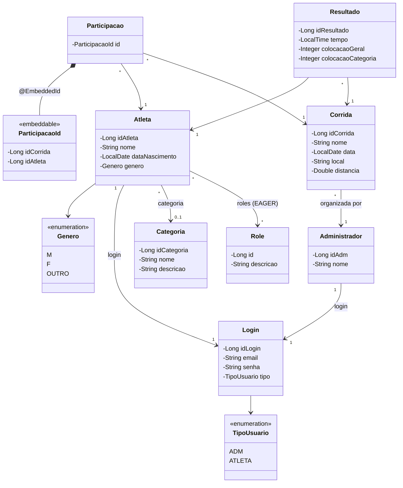
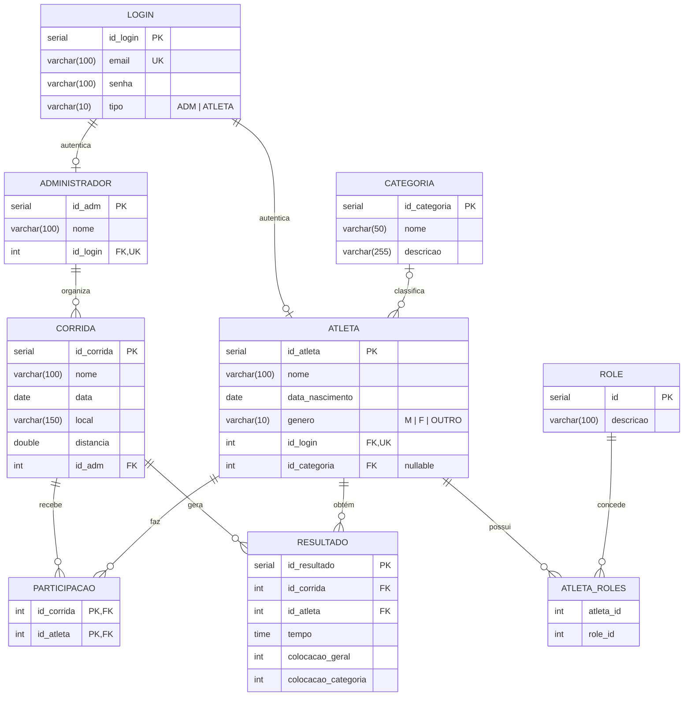

# 3. Modelo de dados

## Diagrama de classes (UML do domínio)

As entidades JPA do pacote `model`, com atributos, enums e multiplicidades:

### Notas do mapeamento

- **Login separado do usuário**: `Atleta` e `Administrador` têm um `Login` próprio (1:1), que guarda credenciais e tipo. O e-mail é único na tabela `login`, então um mesmo e-mail não serve para atleta e administrador ao mesmo tempo.
- **Inscrição com chave composta**: `Participacao` usa `@EmbeddedId ParticipacaoId(idCorrida, idAtleta)` com `@MapsId`. É a chave primária que garante uma inscrição por atleta e corrida.
- **Roles**: relação N:N `Atleta`↔`Role` pela tabela `atleta_roles`, carregada de forma *eager* porque é usada a cada requisição autenticada.
- **Resultado** é independente da inscrição: referencia atleta e corrida diretamente.

## Diagrama entidade-relacionamento (banco)

Tabelas criadas pelas migrações Flyway:

> A tabela `atleta_roles` não tem chave primária nem chaves estrangeiras declaradas no SQL (`V17`). A integridade depende só da aplicação.

## Migrações Flyway

Ficam em `src/main/resources/db/migration` e são aplicadas em ordem na inicialização. O Hibernate está com `ddl-auto=none`, então **toda mudança de schema precisa de uma nova migração** (`V19__...sql`). Nunca edite uma migração já aplicada.

| Versão | Arquivo | O que faz |
|---|---|---|
| V1 | `create_table_login.sql` | Tabela `login` |
| V2 | `insert_login.sql` | 10 logins de exemplo (2 ADM, 8 ATLETA) |
| V3 | `create_table_administrador.sql` | Tabela `administrador` |
| V4 | `insert_administrador.sql` | 2 administradores |
| V5 | `create_table_categoria.sql` | Tabela `categoria` |
| V6 | `insert_categoria.sql` | 5 categorias |
| V7 | `create_table_atleta.sql` | Tabela `atleta` |
| V8 | `insert_atleta.sql` | 8 atletas |
| V9 | `create_table_corrida.sql` | Tabela `corrida` |
| V10 | `insert_corridas.sql` | 5 corridas |
| V11 | `create_table_participacao.sql` | Tabela `participacao` (chave composta) |
| V12 | `insert_participacao.sql` | 8 inscrições |
| V13 | `create_table_resultado.sql` | Tabela `resultado` |
| V14 | `insert_resultado.sql` | 8 resultados |
| V15 | `create_roles.sql` | Tabela `role` |
| V16 | `insert_roles.sql` | Roles `ADMIN` e `USER` |
| V17 | `atleta_roles.sql` | Tabela de junção `atleta_roles` |
| V18 | `inserir_administrador.sql` | Dá a role `ADMIN` ao atleta 1 |

## Dados iniciais

| Tabela | Registros | Observação |
|---|---|---|
| `categoria` | 5 | Juvenil (até 18), Adulto (19–39), Master (40–59), Sênior (60+), Elite |
| `administrador` | 2 | `adm1@corrida.com`, `adm2@corrida.com` |
| `atleta` | 8 | Só o atleta 1 (`clavison@gmail.com`) tem senha em BCrypt e role `ADMIN` |
| `corrida` | 5 | Ex.: Corrida da Primavera (5 km), Maratona da Cidade (42,2 km) |
| `participacao` / `resultado` | 8 / 8 | Inscrições e resultados de exemplo |

> As senhas de exemplo dos outros atletas (`senha123`) e dos administradores (`123456`) estão em **texto puro** no banco. Como o login compara as senhas com BCrypt, esses usuários não conseguem autenticar. Para testar, cadastre um atleta novo pela API (veja [Telas](06-telas.md)).
