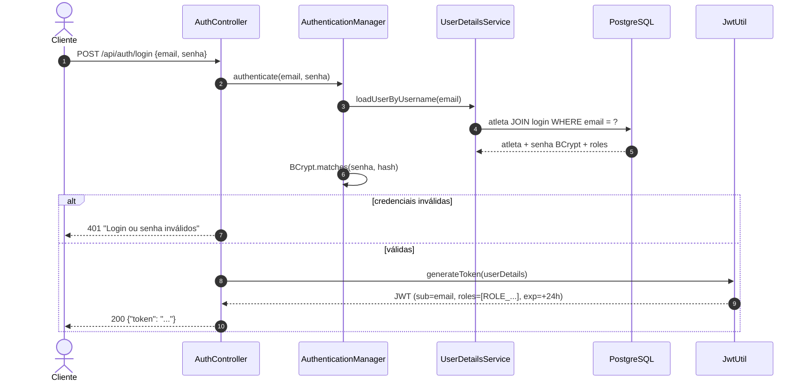
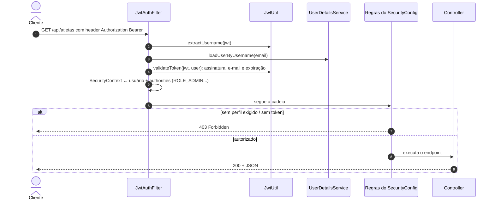

# 5. Segurança

A API é **stateless**: não há sessão no servidor. Cada requisição protegida precisa trazer um JWT no header `Authorization`.

## Componentes

| Classe | Papel |
|---|---|
| `config/SecurityConfig` | Define as regras de acesso por rota, desativa CSRF (API sem cookies), registra o filtro JWT, o `PasswordEncoder` (BCrypt) e o `UserDetailsService` |
| `security/JwtAuthFilter` | Lê `Authorization: Bearer ...`, valida o token e autentica o usuário no `SecurityContext` |
| `security/JwtUtil` | Gera e valida tokens HS256 (assunto = e-mail, claim `roles`, expiração) |
| `controller/AuthController` | `POST /api/auth/login`: autentica com o `AuthenticationManager` e devolve o token |
| `config/SwaggerConfig` | Declara o esquema `bearerAuth` para o botão **Authorize** do Swagger UI |

## Fluxo de autenticação



## Fluxo de uma requisição protegida



## Perfis e matriz de permissões

As roles ficam na tabela `role` (`ADMIN`, `USER`) e são ligadas ao atleta por `atleta_roles`. No token, aparecem com o prefixo `ROLE_`.

| Rota | Visitante | Autenticado sem role | `USER` | `ADMIN` |
|---|:-:|:-:|:-:|:-:|
| `POST /api/auth/login` | ✅ | ✅ | ✅ | ✅ |
| `POST /api/atletas` (cadastro) | ✅ | ✅ | ✅ | ✅ |
| Swagger UI e `/v3/api-docs` | ✅ | ✅ | ✅ | ✅ |
| `GET /api/atletas/**` | ❌ 403 | ❌ 403 | ✅ | ✅ |
| `PUT`/`DELETE /api/atletas/**` | ❌ 403 | ❌ 403 | ❌ 403 | ✅ |
| Todas as demais rotas `/api/**` | ❌ 403 | ✅ | ✅ | ✅ |

Comportamentos conferidos na API rodando:

- sem token, `GET /api/corridas` responde **403**;
- um atleta recém-cadastrado (sem role) recebe **403** em `GET /api/atletas`, mas **200** em `GET /api/corridas`;
- com a role `ADMIN`, todas as rotas respondem normalmente.

## Senhas

- Atletas: criptografadas com **BCrypt** no cadastro (`AtletaService.create`) e na troca de senha (`AtletaService.update`, só quando uma nova senha é enviada).
- Administradores: **não** são criptografadas (veja [Limitações](08-limitacoes-e-melhorias.md)).

## Atribuir uma role a um atleta

Ainda não existe endpoint para isso. Por enquanto, faça direto no banco:

```sql
-- dá o perfil ADMIN ao atleta com o e-mail informado
INSERT INTO atleta_roles (atleta_id, role_id)
SELECT a.id_atleta, r.id
FROM atleta a
JOIN login l ON l.id_login = a.id_login
JOIN role  r ON r.descricao = 'ADMIN'
WHERE l.email = 'ana.demo@runevent.com';
```

O novo perfil vale a partir do **próximo login**, porque as roles são gravadas no token.

## CORS

`CorsConfig` libera qualquer origem (`*`) para `GET`, `POST`, `PUT`, `DELETE` e `OPTIONS`, sem credenciais. Isso basta para apps mobile e front-ends em desenvolvimento. Em produção, restrinja as origens.

## Recomendações para produção

1. Defina `JWT_SECRET` com uma chave aleatória de pelo menos 32 bytes. A chave padrão está no código-fonte.
2. Use `DB_PASSWORD` e não a senha padrão do `application.properties`.
3. Restrinja o CORS aos domínios dos clientes.
4. Resolva os itens de segurança listados em [Limitações](08-limitacoes-e-melhorias.md), principalmente a exposição de senhas nas respostas.
