# 6. Telas

O RunEvent é uma API: a interface de uso e de teste é o **Swagger UI**, gerado automaticamente a partir dos controllers.

- Endereço: http://localhost:8081/swagger-ui/index.html (com a aplicação rodando)

Os prints abaixo mostram o fluxo completo de uso, capturados com a aplicação rodando sobre o banco com os dados iniciais das migrações.

---

## 6.1 Visão geral dos endpoints

A página inicial agrupa os endpoints por recurso (administradores, roles, corridas, categorias, atletas, resultados, participações e autenticação). No fim fica a seção **Schemas**, com os modelos de entrada e saída. O cadeado em cada rota indica que ela aceita o token JWT.

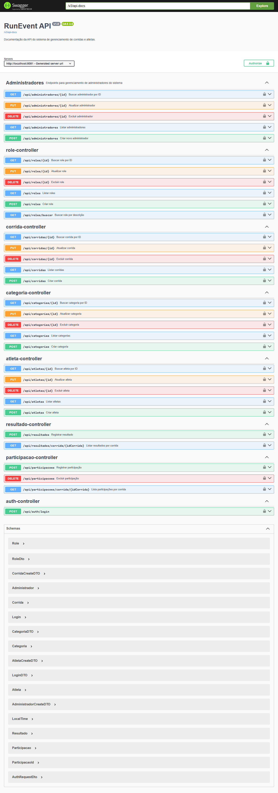

---

## 6.2 Login e obtenção do token

Em **auth-controller → POST /api/auth/login**, clique em **Try it out**, informe e-mail e senha e clique em **Execute**. A resposta `200` traz o `token`.

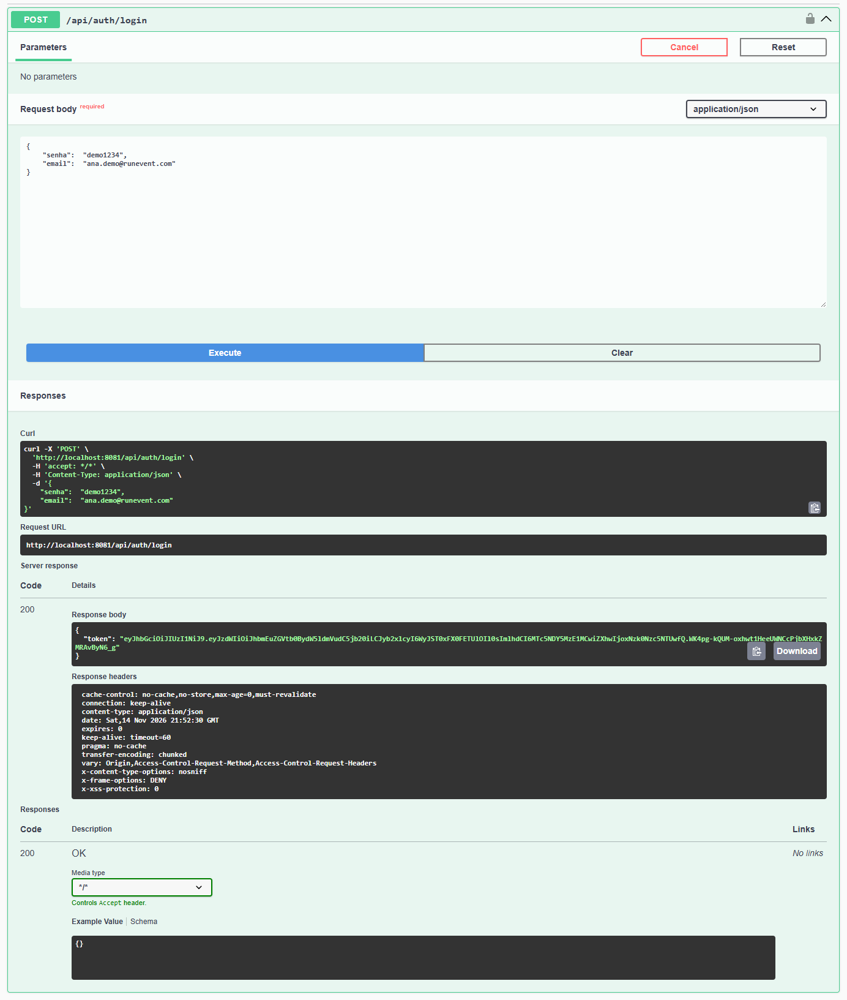

---

## 6.3 Rota protegida sem token

Antes de autorizar, uma chamada a uma rota protegida (aqui `GET /api/corridas`) responde **403 Forbidden**.

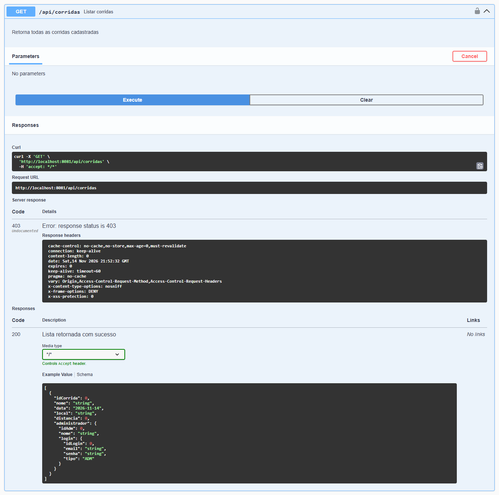

---

## 6.4 Autorizando o Swagger com o JWT

Clique no botão **Authorize** (canto superior direito), cole o token no campo **Value** do esquema `bearerAuth` e confirme. A partir daí, o Swagger envia `Authorization: Bearer <token>` em todas as chamadas.

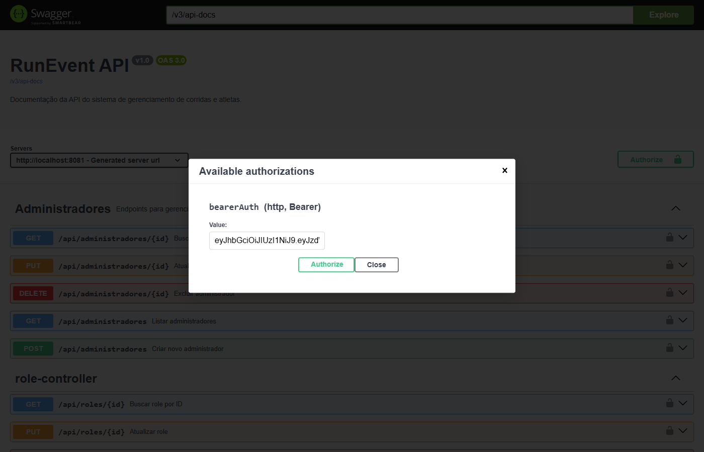

---

## 6.5 Listando corridas

Com o token, `GET /api/corridas` responde `200` com as corridas e seus organizadores.

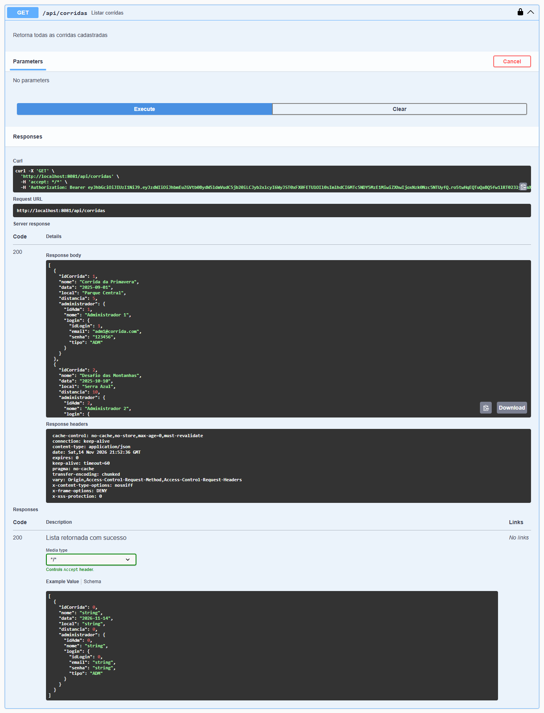

---

## 6.6 Cadastro de atleta

`POST /api/atletas` é público. O corpo leva os dados do atleta, o login e, opcionalmente, a categoria. A resposta `201` mostra a senha já criptografada com BCrypt e o header `Location`.

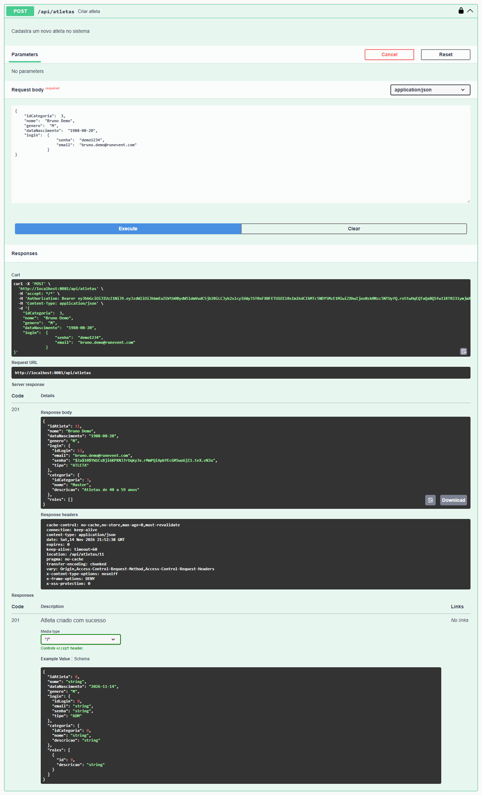

Se o e-mail já existir, a regra de unicidade responde `400`:

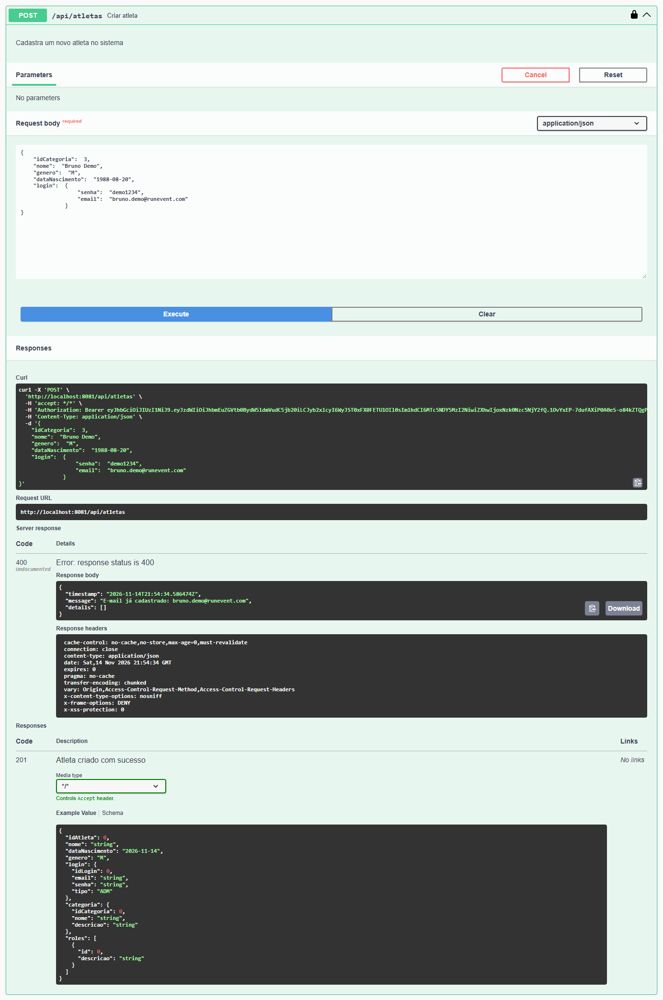

---

## 6.7 Criando uma corrida

`POST /api/corridas` recebe o organizador no parâmetro `idAdm` e os dados da corrida no corpo.

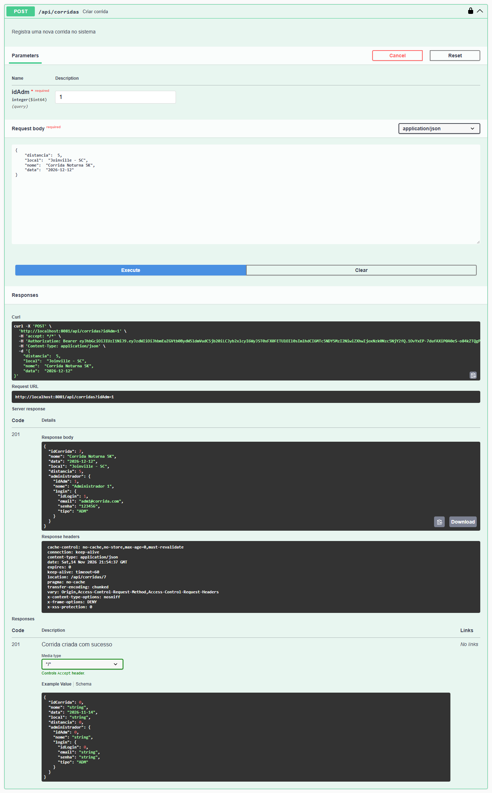

---

## 6.8 Inscrição duplicada

`POST /api/participacoes?idAtleta=9&idCorrida=1` para um atleta já inscrito devolve `400` com a mensagem da regra de negócio.

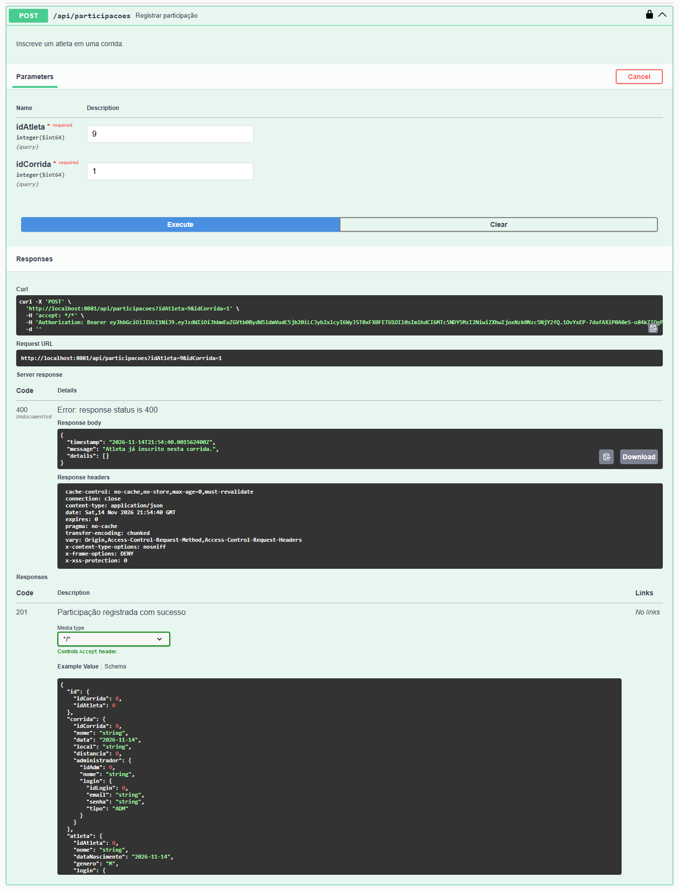

---

## 6.9 Resultados de uma corrida

`GET /api/resultados/corrida/{idCorrida}` lista tempo e colocações (geral e por categoria) de cada atleta.

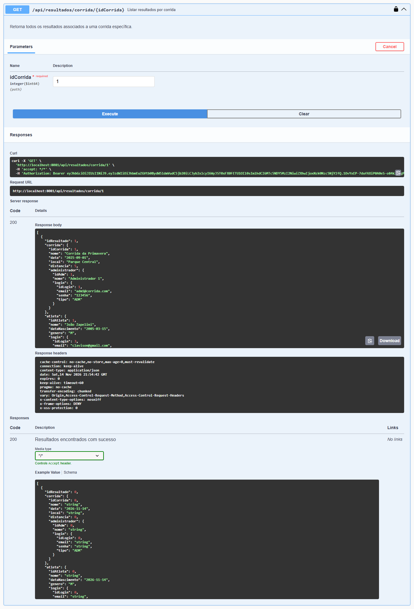

---

## 6.10 Schemas

Os modelos documentados: entidades (`Atleta`, `Corrida`, `Resultado`…) e DTOs de entrada (`AtletaCreateDTO`, `CorridaCreateDTO`, `AuthRequestDto`…).

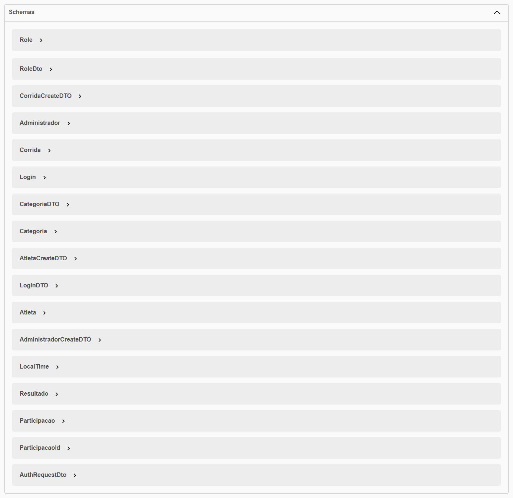

---

## Reproduzindo as telas

1. Suba a aplicação (veja o [README](../README.md#como-executar)).
2. Cadastre um atleta em `POST /api/atletas`.
3. Para ver todas as rotas, dê a role `ADMIN` a esse atleta (SQL em [Segurança](05-seguranca.md#atribuir-uma-role-a-um-atleta)).
4. Faça login, use **Authorize** e explore os endpoints.
