# 7. Testes

## Estratégia

```mermaid
flowchart TB
    subgraph U["Testes unitários: service"]
        direction LR
        ST["*ServiceTest<br/>@ExtendWith(MockitoExtension)"] --> SV["Service real"]
        SV --> MR["Repositories mockados"]
    end
    subgraph W["Testes da camada web: controller"]
        direction LR
        CT["*ControllerTest<br/>@WebMvcTest + MockMvc"] --> CR["Controller real<br/>+ GlobalExceptionHandler"]
        CR --> MS["Services mockados (@MockBean)"]
    end
    subgraph I["Teste de integração"]
        direction LR
        AT["RuneventApplicationTests<br/>@SpringBootTest"] --> CTX["Contexto completo<br/>+ Flyway"]
        CTX --> PG[("PostgreSQL real")]
    end
```



| Tipo | Classes | O que valida | Precisa de banco? |
|---|---|---|---|
| Unitário | `AdministradorServiceTest`, `AtletaServiceTest`, `CategoriaServiceTest`, `CorridaServiceTest`, `LoginServiceTest`, `ParticipacaoServiceTest`, `ResultadoServiceTest` | Regras de negócio: e-mail único, inscrição duplicada, entidade não encontrada, criptografia de senha | Não |
| Web | `AdministradorControllerTest`, `AtletaControllerTest`, `CategoriaControllerTest`, `CorridaControllerTest`, `ParticipacaoControllerTest`, `ResultadoControllerTest` | Status HTTP, JSON de resposta (`jsonPath`) e tradução de exceções em 400 | Não |
| Integração | `RuneventApplicationTests` | A aplicação sobe por completo e as migrações rodam | **Sim** |

Os testes de controller usam `@AutoConfigureMockMvc(addFilters = false)`. Eles verificam a camada web isoladamente, e as regras de acesso ficam fora deles (veja [Segurança](05-seguranca.md)).

## Como executar

```bash
# todos os testes (o teste de integração precisa do PostgreSQL configurado)
./mvnw test

# apontando para outro banco
DB_URL=jdbc:postgresql://localhost:5433/runevent DB_PASSWORD=minhasenha ./mvnw test

# só os testes que não usam banco
./mvnw test -Dtest='*ServiceTest,*ControllerTest'
```

No Windows, use `mvnw.cmd` e defina as variáveis com `$env:DB_PASSWORD="..."` (PowerShell).

## Resultado atual

Execução completa com PostgreSQL disponível:

| Suite | Testes | Resultado |
|---|---|---|
| Services (7 classes) | 23 | ✅ |
| Controllers (6 classes) | 26 | ✅ |
| Integração (1 classe) | 1 | ✅ |
| **Total** | **50** | **✅ 50/50** |

## Escrevendo novos testes

- **Regra de negócio nova** → teste unitário no `*ServiceTest` correspondente, com repositórios mockados.
- **Endpoint novo** → teste em `*ControllerTest` com `MockMvc`, cobrindo o caminho feliz e o erro (400).
- **Mudança de schema** → crie a migração `V19__...sql` e rode o `RuneventApplicationTests` para confirmar que ela é aplicada.
